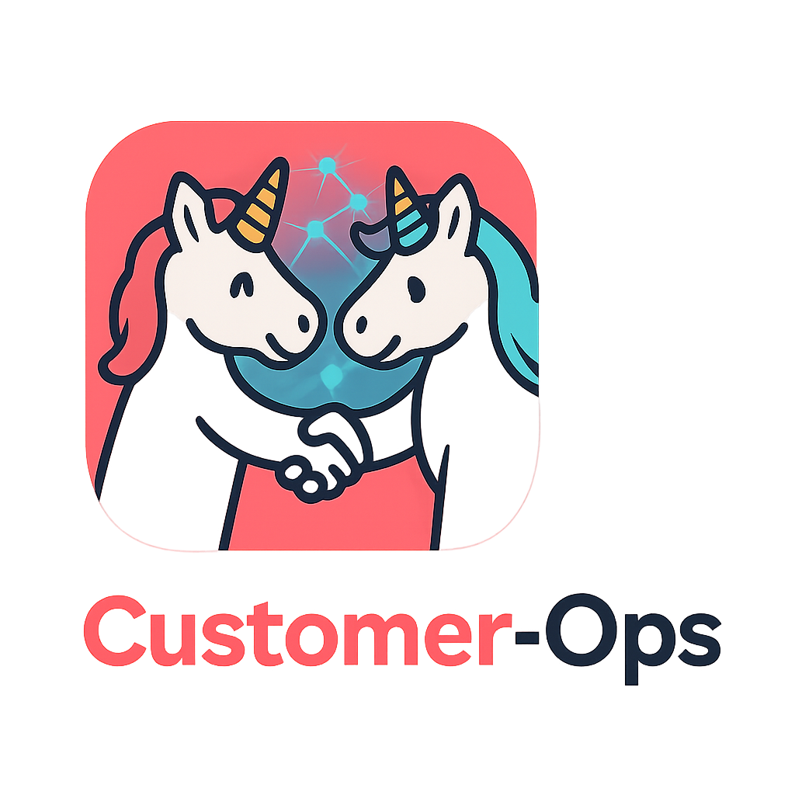

<div align="center">



### Every relationship, connected.

**The relationship brain of the [Unicorn Commander](https://unicorncommander.ai) suite** — a graph‑native CRM that federates your people, meetings, projects, and invoices into one living relationship graph, worked by agents, on infrastructure you own.

[](#)
[](#sovereign-by-design)
[](#the-living-graph)
[](#stack)
[](#stack)
[](#stack)
[](#the-living-graph)
[](#security--tenancy)

</div>

---

## What it is

Customer‑Ops runs the **whole customer lifecycle in one cockpit** — source a lead, work it through outreach, qualify, convert, then keep the relationship warm — and it draws every contact, invoice, email thread, campaign, meeting, and project into a single **customer‑360** and a **living relationship graph**.

It does this without becoming yet another silo. Customer‑Ops is a **surface, not an engine**: it owns the _relationship_ — the lifecycle stage, the pipeline, the provenance — and it **federates** everything else from the apps that already own it. There is no second phonebook here, no second ledger. Just the relationship, and a clear line of sight to everything connected to it.

> **The golden rule:** a "lead" is just a contact in the one Contact‑Ops phonebook at an early stage. Customer‑Ops manages the _stage and the pipeline view_; the contact record itself never moves or copies.

---

## What makes it different

|                                  |                                                                                                                                                                                                                   |
| -------------------------------- | ----------------------------------------------------------------------------------------------------------------------------------------------------------------------------------------------------------------- |
| 🟥 **Sovereign by design**       | Runs entirely on infrastructure you own — your Postgres, your graph, your models. No data leaves for a vendor cloud. The AI runs on your GPUs by default.                                                         |
| 🕸️ **Graph‑native**              | Every contact, deal, org, meeting, invoice, and campaign is a node in a real per‑workspace property graph (FalkorDB). The cockpit isn't a list of records — it's a network you can walk.                          |
| 🤖 **Agents as named residents** | The **Relations Officer** and its sub‑agents are first‑class colleagues, not a chat box. They propose; you decide. They run on your local models, with a one‑flag escalation to frontier when a task warrants it. |
| 🔗 **Federate, don't fork**      | Six sibling apps surface live through typed seams — brokered, audited, and degrade‑clean. A source going dark never breaks the cockpit; it just shows "connect."                                                  |

---

## The cockpit

The **customer‑360** is the heart of Customer‑Ops — one screen that assembles the local relationship and the federated world around a contact:

- **Pipeline** — every relationship bucketed by stage (Lead → Prospect → Customer), with per‑lane value and the next action.
- **Relationship timeline** — stage changes, notes, and engagement, in order.
- **Federated panels**, resolved live at read time, never copied locally:
  - 👤 **Contact** — name, org, comms strength (from Contact‑Ops)
  - 📊 **Projects** — the delivery work running for this account (from Project‑Ops)
  - 🧾 **Invoices** — live AR status (from Accounting‑Ops)
  - ✉️ **Email** — mailbox threads + send (from Email‑Ops)
  - 📅 **Meetings** — meetings, summaries, action items (from Meeting‑Ops)
  - 📣 **Outreach** — campaigns + touches (from Outreach)
- **The graph** — the contact's ego‑network: who they work with, what they own, how they were sourced.

---

## The living graph

Customer‑Ops projects the relationship world onto a **per‑workspace knowledge graph** in [FalkorDB](https://www.falkordb.com/) — a real typed property graph, not a UI gimmick.

```
        (Org)
          ▲ WORKS_AT
          │
 (Hub)──IS_CONTACT──▶(Person)──OWNS_DEAL──▶(Deal)
          │              │
          │              ├─ATTENDED──▶(Meeting)
          │              ├─BILLED_FOR─▶(Invoice)
          │              ├─EMAILED────▶(Email)
          │              ├─ENROLLED_IN▶(Campaign)
          │              └─SOURCED_FROM▶(LeadSource)
```

**Nodes:** Person · Org · Deal · Meeting · Invoice · Email · Campaign · LeadSource · Hub.
**Edges:** typed and time‑weighted, so the renderer can emphasize bigger deals and warmer relationships.

It stays current automatically — every relationship write fires a **post‑commit, incremental graph refresh** (no nightly rebuild, no drift), and a full `POST /graph/reindex` rebuilds a workspace from scratch any time. Every key flows through one tenancy chokepoint (`cust_ops:ws:<workspaceId>`), and every value rides as a parameter — injection‑safe by construction.

---

## The Relations Officer


The relationship layer is run by a named orchestrator — the **Relations Officer** — that dispatches to a focused sub‑agent team:

| Agent               | What it does                          |
| ------------------- | ------------------------------------- |
| `lead-triage`       | Scores and routes a new lead          |
| `next-best-action`  | Recommends the next move on a contact |
| `meeting-prep`      | Builds a pre‑meeting brief            |
| `follow-up-drafter` | Drafts a follow‑up message            |
| `collections-nudge` | Nudges on overdue invoices            |

**Local‑first, with a frontier lane.** Every agent runs on your local models by default (`qwen3.6‑35b‑a3b`, thinking off) and can be routed to frontier (`claude‑sonnet‑4.6`) per call with `?tier=metered` — no redeploy. A live A/B across all five agents found **no‑think Qwen matches Claude** for these tasks after light prompt calibration, so the default lane is local, private, and free; frontier is there when a job earns it.

> Agents **propose; you decide.** Nothing side‑effectful happens without a person in the loop.

---

## How it federates

Customer‑Ops calls each sibling app as a service over its MCP surface, authenticated by a **Brigade‑brokered, workspace‑scoped token** (RFC‑8693 exchange) — never a shared static secret. Each seam is independently guarded and **degrade‑clean**: unconfigured or unreachable, it renders "connect" and makes no call.

| Seam               | Federates                         | Source of truth             |
| ------------------ | --------------------------------- | --------------------------- |
| **Contact‑Ops**    | contacts, orgs, sourcing          | the one canonical phonebook |
| **Accounting‑Ops** | invoices, AR status               | the one AR/invoicing engine |
| **Meeting‑Ops**    | meetings, summaries, action items | conversation intelligence   |
| **Project‑Ops**    | projects, delivery status         | project & client operations |
| **Email‑Ops**      | mailbox threads, send             | the mail surface            |
| **Outreach**       | campaigns, social touches         | the outreach surface        |

**See it at a glance.** `GET /health/integrations` probes every seam and reports `ok` / `auth-error` / `unreachable` / `not-configured` per integration — so a silent auth failure can never hide behind an empty panel.

```jsonc
{
  "seams": [
    { "seam": "contact-ops", "ok": true, "status": 200, "detail": "ok" },
    { "seam": "project-ops", "ok": true, "status": 200, "detail": "ok" },
    { "seam": "accounting-ops", "ok": false, "status": 401, "detail": "auth-error: ..." },
  ],
}
```

---

## The funnel

```
source ──▶ lead ──▶ outreach ──▶ engage / qualify ──▶ prospect ──▶ convert ──┐
 (Contact-Ops)        (Outreach)   (+Meeting signal)                          │
                                                                              ├─▶ product customer  (entitlement)
                                                                              └─▶ services client   (Project-Ops)
                                                                                       │
                                                                                  deliver · bill · retain
```

Inbound signal (a reply, a click, a bounce) flows back as a **stage change**, so the pipeline reflects reality without manual bookkeeping.

---

## Quickstart

Requires Docker Engine with Docker Compose v2 (`--wait` support), Node.js 20 or
newer for credential generation, and Git. This loopback installation includes
PostgreSQL, a private Keycloak realm, the API and UI. It needs no shared Docker
network, DNS, suite account or federation service.

```bash
git clone https://github.com/Unicorn-Commander/customer-ops-community.git
cd customer-ops-community
node deploy/selfhost/bootstrap.cjs
docker compose --env-file deploy/.env -f deploy/docker-compose.selfhost.yml up -d --build --wait --wait-timeout 300
curl -fsS http://127.0.0.1:3211/api/v1/health/live
curl -fsS http://127.0.0.1:3211/api/v1/health/ready
```

Open **http://127.0.0.1:3000**, choose the single sign-on button, and sign in as
`admin` using `CUSTOMER_OPS_ADMIN_PASSWORD` from the generated `deploy/.env`
(open that file locally). The bundled `customer-ops` realm contains this account
with the synthetic email `admin@example.invalid`. First login creates the
Customer-Ops user and an **OWNER** membership in the local workspace. The API
runs under the separate `customer_ops_app` role with enforced row-level security.

The initializer writes `deploy/.env` with owner-only permissions, refuses to
overwrite an existing file, and never prints credentials. `.env` is Git-ignored;
`git status --short --untracked-files=all` should show no generated secret file.
To start an existing installation again, run the compose command without rerunning
the initializer. Keep the generated credentials and Docker volumes together;
editing bootstrap passwords does not reset an existing Keycloak realm.

Keycloak is available only at **http://127.0.0.1:8080**. Its separate management
account is `keycloak-admin`, with `KEYCLOAK_ADMIN_PASSWORD` from `deploy/.env`.
Realm self-registration is disabled. `CUSTOMER_OPS_SIGNUP_MODE=open` permits users
created in this local realm to receive their own Customer-Ops workspace; it does
not enable public account registration. Use `127.0.0.1` consistently, since the
callback, CORS origin and frontend API URL are configured for it. This HTTP
quickstart is for access from the Docker host; remote access requires a separate
HTTPS and identity-provider configuration.

Federation `*_BASE_URL`, graph, inference and entitlement-source URLs are blank
by default. The local pipeline and provisional leads work without those services;
connected panels report their unconfigured state. No suite broker or registry is
required. `UC_ENTITLEMENT_MODE=open` permits local self-host use without suite
entitlements. The optional integrations and their credentials remain in
`deploy/.env.example` for later configuration.

### Agent token after sign-in

In **Settings → API tokens**, create a token with the scopes you need and an
expiry. Copy the `co_pat_` value when it is shown; the plaintext is returned only
once. Use it as `Authorization: Bearer <token>` with
`http://127.0.0.1:3211/api/v1/mcp`. Revoke it from the same Settings page.

The API equivalent is `POST /api/v1/auth/pats`, authenticated with the admin's
existing session JWT. The body accepts `name`, `scopes`, optional `workspaceId`
(defaults to the admin's workspace), and an ISO `expiresAt`. For example, request
`read:customers` and a short expiry for an acceptance check. The response field
`plaintext` contains the token. A PAT cannot mint another PAT, and omitting
`expiresAt` creates a non-expiring token.

---

## Stack

| Layer        | Tech                                                                                 |
| ------------ | ------------------------------------------------------------------------------------ |
| **Backend**  | NestJS 10 · Prisma 5 · PostgreSQL 17 (RLS‑enforced multi‑tenancy)                    |
| **Graph**    | FalkorDB (per‑workspace property graph)                                              |
| **Frontend** | Next.js 15 · React · Tailwind · `react-force-graph`                                  |
| **Identity** | Keycloak (bundled self-host realm, RS256 SSO) · Brigade (RFC‑8693 federation broker) |
| **AI**       | LiteLLM gateway → local Qwen (default) ↔ frontier Claude (opt‑in), Lago‑metered      |
| **Agents**   | MCP server — the same relationship logic an HTTP caller hits                         |

```
Customer-Ops/
├── backend/         NestJS API + MCP server
│   └── src/
│       ├── customers/      relationship logic · funnel · customer-360
│       ├── graph/          FalkorDB knowledge graph (ingest · read · health)
│       ├── agents/         the Relations Officer + sub-agents (selectable lane)
│       ├── {contact,accounting,email,meeting,project,outreach}-ops/   federation seams
│       ├── lead-intake/    the `ingest_lead` front door
│       ├── health/         liveness · readiness · /health/integrations
│       └── common/         workspace (RLS GUC chokepoint) · federation (Brigade)
├── frontend/        Next.js cockpit
├── deploy/          Docker Compose + env
└── docs/            runbooks · legal · architecture
```

---

## Security & tenancy

- **DB‑enforced isolation.** Every tenant boundary is Postgres **Row‑Level Security** (`ENABLE` + `FORCE`) behind a `current_workspace_id()` GUC chokepoint, run under a `NOBYPASSRLS` application role. The graph mirrors it with a per‑workspace key on every node and edge.
- **Brokered federation.** Cross‑app calls carry a short‑lived, workspace‑scoped, audience‑bound token minted via Brigade — auditable through the `act` chain, never a shared secret.
- **Agents in the loop.** The relationship agents propose; a person confirms anything side‑effectful. Inference is metered and runs local‑first.
- **Sovereign.** Data and models stay on infrastructure you control.

---

## Docs

|                                |                                                                                                   |
| ------------------------------ | ------------------------------------------------------------------------------------------------- |
| 📖 User guide                  | [`docs/USER-GUIDE.md`](docs/USER-GUIDE.md) — the cockpit, surface by surface                      |
| 🏗️ Architecture                | [`docs/ARCHITECTURE.md`](docs/ARCHITECTURE.md) — federation · graph · tenancy · agents            |
| 🏛️ Architecture foundation     | [`docs/PHASE-1-FOUNDATION.md`](docs/PHASE-1-FOUNDATION.md)                                        |
| 🪪 Identity & tenancy contract | [`docs/SUITE-IDENTITY.md`](docs/SUITE-IDENTITY.md)                                                |
| 📓 Runbooks                    | [`docs/runbooks/`](docs/runbooks/) — deploy · backup/restore · tenancy · inference · entitlements |
| ⚖️ Legal & trust               | [`docs/legal/`](docs/legal/) — privacy · DPA · ToS · AUP · security                               |
| 📜 Changelog                   | [`CHANGELOG.md`](CHANGELOG.md)                                                                    |

---

## License

Apache-2.0 (see [`LICENSE`](LICENSE)).

---

<div align="center">

**Customer‑Ops** — part of the Unicorn Commander suite.
_A surface, not an engine. Every relationship, connected._

</div>
