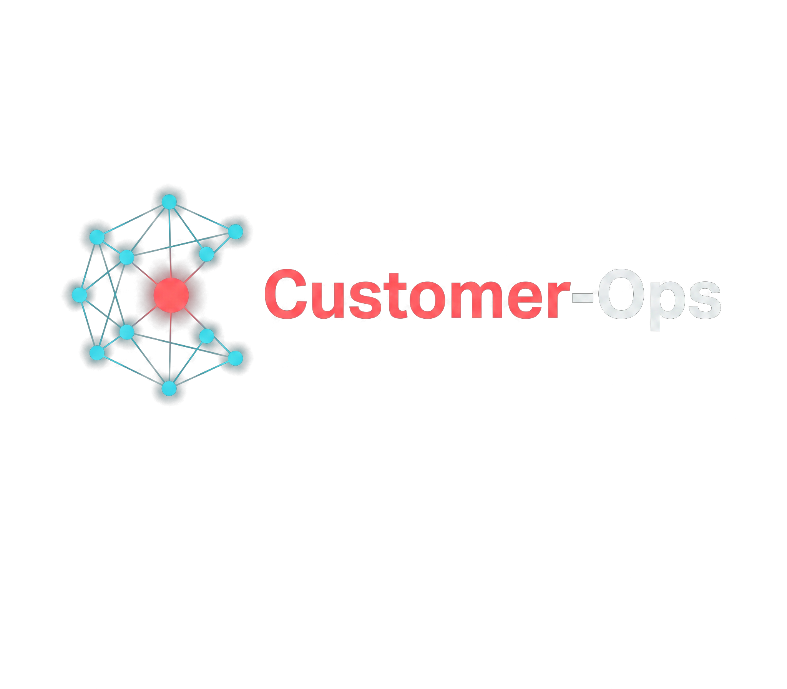
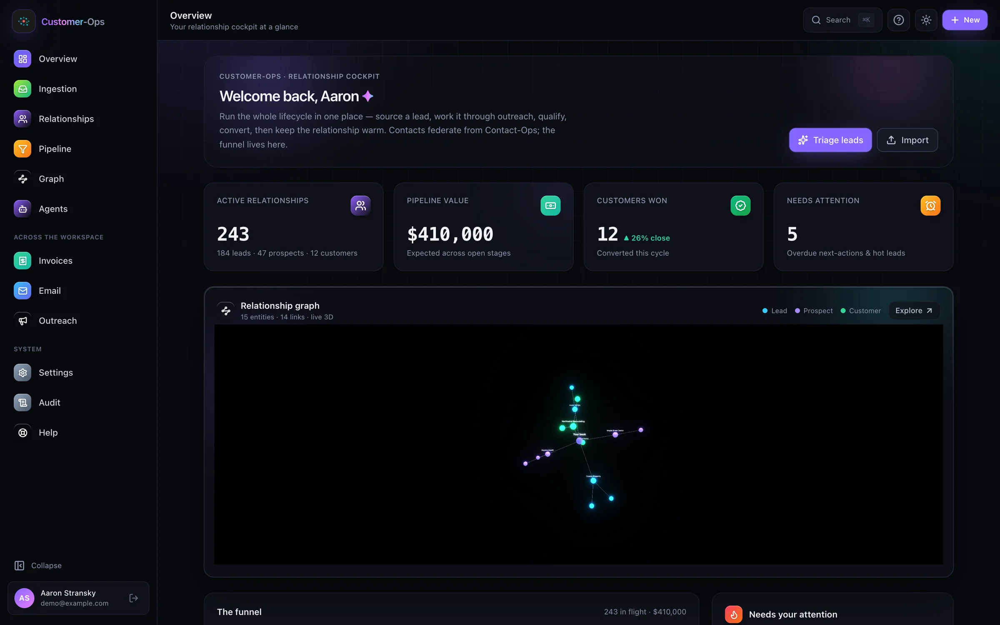
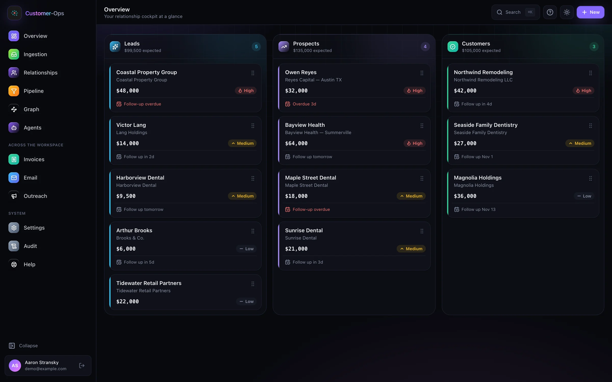
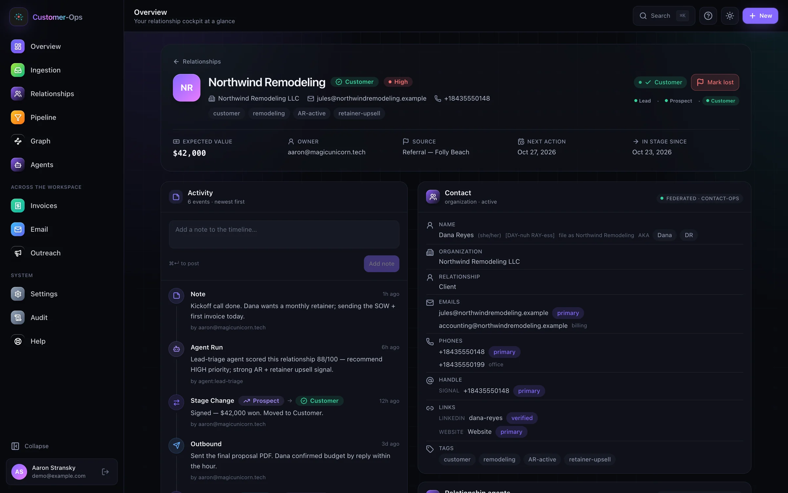
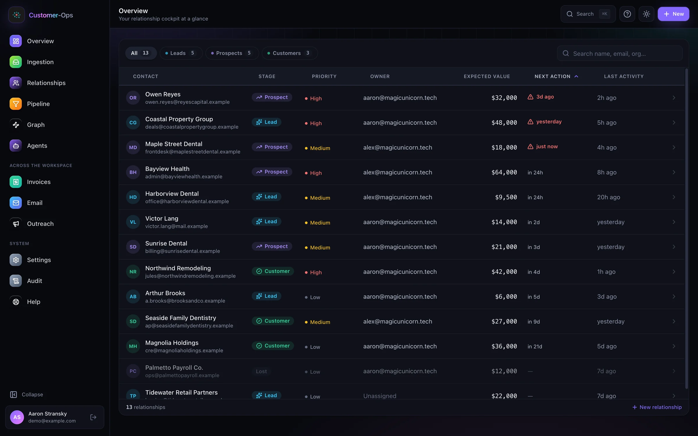

# Customer-Ops

### The relationship and funnel cockpit for leads, customers, quotes, and outreach.

*Every relationship, connected.*

[Quick start](#quick-start) · [Features](#highlights) · [Agents](#built-for-agents) · [Architecture](#architecture) · [Suite](#part-of-unicorn-commander)

  

## What is Customer-Ops?

Customer-Ops is the relationship and funnel cockpit for turning leads into customers and keeping the work around each relationship visible. It owns the lifecycle — stage, pipeline, notes, next actions, and optional quotes — and reads contact, invoice, meeting, project, email, outreach, and device-conversation context from the apps that own those records. A lead stays a contact in Contact-Ops. Customer-Ops stores the stage and a contact reference, not a second phonebook or a second ledger.

The self-host stack runs Keycloak SSO with Postgres row-level security enforced: tenancy is on, and the API connects as the `NOBYPASSRLS` role `customer_ops_app`. Relationship agents and the Relations Officer return assessments, drafts, or a single proposed write. A person confirms that proposal, and outbound mail from those agents is staged for approval. Other REST and MCP writes run when the caller's workspace role and PAT scopes allow them, including an explicit email send. `backend/package.json`, `frontend/package.json`, and the MCP server info all say version 0.12.0. `CHANGELOG.md` stops at the 0.12.0 heading dated 2026-06-23, so quotes and the self-host stack are in this tree without a newer changelog heading.

## Highlights

- **A guarded relationship funnel.** Stages are Lead, Prospect, and Customer. A forward move is exactly one step, so a lead cannot skip qualification. Moving backward any number of steps is allowed. Lost and reopen are a separate flag, not a fourth stage. The relationship stores expected value, priority, `ownerUserKey`, and `nextActionAt`. A reply or click can advance the same one step. Opens, bounces, and unsubscribes do not, and a lost relationship does not advance until it is reopened.
- **Customer-360 without a second phonebook.** The relationship record keeps a Contact-Ops reference. Customer detail assembles that contact plus invoice, meeting, project, email, outreach, and device-conversation panels at read time, along with the local timeline, quotes, and agent actions. Each system remains the source of truth for its own data.
- **A navigable relationship graph.** Each workspace is one [FalkorDB](https://www.falkordb.com/) graph, keyed `cust_ops:ws:<workspaceId>`. Relationship writes refresh it after commit. `POST /api/v1/workspaces/:workspaceId/graph/reindex` rebuilds that workspace. With `FALKORDB_URL` unset, the API returns 503 for graph reads and the explorer projects the customer rows instead.
- **An idempotent lead front door.** `ingest_lead` stages an enriched lead, resolves identity through Contact-Ops when that seam is reachable, and by default keeps a provisional identity (`LEAD_INTAKE_PROVISIONAL_IDENTITY`, on unless set to `false`, `0`, `no`, or `off`) so the intake is not dropped. `resolve_pending_leads` promotes pending intakes and upgrades provisional ids once Contact-Ops is reachable.
- **Quotes and proposals.** Quote routes, the renderer, and the quote MCP tools register only when `QUOTES_ENABLED` is `true` or `1`. The flag is not listed in `deploy/.env.example`; unset means off. The workspace stores sections, line items, options, recipients, versions, and events. Sending a quote stages an Email-Ops approval draft (`mode=draft`). It does not deliver the proposal itself.
- **Agents that prepare a draft or a proposal.** The five relationship agents return a lead assessment, a next action, a meeting brief, a follow-up draft, or a collections draft. Follow-up and collections can stage that draft in the Email-Ops approval inbox. Those runs do not auto-send, post an invoice, or move a stage. The Relations Officer can propose one of four writes — stage change, note, mark lost, or reopen — and runs it only after a person confirms. Separate MCP tools can transition a stage, create an invoice, or send mail when the token's scopes allow it.
- **Security at the workspace boundary.** Keycloak SSO, membership checks when tenancy is on, Postgres row-level security on workspace-scoped tables, scoped Personal Access Tokens, and an append-only `audit_logs` trail. Relationship writes and agent runs are audited on both the REST and MCP paths. The runtime role is `customer_ops_app` (`NOBYPASSRLS`). Migrations use the owner role.
- **Optional integrations that fail clearly.** An unconfigured or unreachable seam makes no call and the cockpit shows a connect state. `GET /api/v1/health/integrations` probes contact-ops, accounting-ops, outreach, email-ops, conversations-ops, meeting-ops, project-ops, and the Microsoft 365 connector. Each row includes `configured`, `ok`, HTTP `status`, and a `detail` of `ok`, `not-configured`, `auth-error`, or `unreachable`.

## Feature tour

### Pipeline

  

The pipeline board has one lane per lifecycle stage. Each card shows expected value, priority, and the next action when `nextActionAt` is set. Drag-and-drop calls the same `transitionStage` API as other clients. The server applies the one-step forward rule, and a rejected drop rolls the board back.

### Customer-360

  

Open one relationship to see its federated contact, local activity timeline, quotes, invoices, email, outreach, meetings, projects, device conversations, and the agent actions. Local links store the foreign id and provenance. They do not copy the sibling record.

### Relationship graph

  

The graph explorer can inspect a node and expand its neighborhood. Node labels are Person, Org, Deal, Meeting, Email, Invoice, Campaign, Project, Doc, Product, LeadSource, and Hub. Edge types include `WORKS_AT`, `IS_CONTACT`, `OWNS_DEAL`, `ATTENDED`, `BILLED_FOR`, `PAID`, `ENROLLED_IN`, `EMAILED`, `THREAD_WITH`, `SOURCED_FROM`, and `STAGE_EVENT`. If FalkorDB is dormant or unreachable, the page builds a graph from `listCustomers` instead.

### Quotes

With `QUOTES_ENABLED=true` (or `1`), Customer-Ops keeps draft composition, commercial structure, rendered HTML or PDF, versions, and events. The send path composes an Email-Ops draft for a person to approve. A public acceptance flow can later email a verification code with `mode=send`. Quote theme tokens can be read from Brand-Ops when `BRAND_OPS_BASE_URL` is set; otherwise the renderer uses its default theme. Brand-Ops is not one of the `/health/integrations` rows.

### Lead intake

The lead intake surface shows what arrived, which identity path succeeded, and what is still pending or failed. `resolve_pending_leads` promotes pending intakes, and with `scope=pending_and_failed` it also promotes failed ones. It upgrades provisional contact ids once Contact-Ops is reachable. Discard sets the intake to `DISCARDED`, and that status is not in the resolve scan. A resolved intake cannot be discarded; mark the relationship lost instead.

## Built for agents

Customer-Ops exposes a Streamable HTTP MCP server at `/api/v1/mcp`. `JwtAuthGuard` accepts a local HS256 session JWT, a Keycloak realm RS256 JWT, or a Brigade federation RS256 JWT whose audience is `customer-ops`, and it accepts a scoped `co_pat_` Personal Access Token. Create a PAT from **Settings → API tokens** or `POST /api/v1/auth/pats` (session JWT only). PAT calls are checked against the tool's scope and the token's workspace binding. A PAT cannot mint or revoke a PAT. The plaintext is returned once. Omitting `expiresAt` stores a non-expiring token. Revoke it from the same Settings page or `DELETE /api/v1/auth/pats/:id`.

The server registers **24 core tools**: `health`, `list_my_workspaces`, `list_customers`, `get_customer_360`, `pipeline_board`, `transition_customer_stage`, `add_customer_note`, `update_customer`, `list_customer_invoices`, `create_customer_invoice`, `list_customer_outreach`, `start_customer_campaign`, `list_customer_email`, `send_customer_email`, `record_customer_engagement`, `list_customer_meetings`, `triage_customer`, `draft_followup`, `draft_collections_nudge`, `ingest_lead`, `lead_intake_stats`, `list_lead_intakes`, `resolve_pending_leads`, and `discard_lead_intake`. When quotes are enabled it adds **20 quote tools** (13 draft and price-book operations plus `render_quote`, `send_quote`, `supersede_quote`, `revoke_share_link`, `record_quote_acceptance`, `list_quote_versions`, and `list_quote_events`). `send_customer_email` defaults to `mode=draft`. `mode=send` queues delivery unless the workspace agent pause switch is on. `record_customer_engagement` can advance the stage on a reply or click.

The REST agent routes, all under `/api/v1/workspaces/:workspaceId/customers/:id/agents/`, are `triage` (lead-triage), `follow-up` (follow-up-draft), `collections-nudge`, `next-best-action`, and `meeting-prep`. Each accepts a `tier` of `bundled` or `metered` on the body or `?tier=` query. The body wins. A metered request without the `ai-metered` entitlement is downgraded to bundled, unless `UC_ENTITLEMENT_MODE=open`. Next-best-action and meeting-prep are REST-only. They are not MCP tools.

The Relations Officer is `POST /api/v1/workspaces/:workspaceId/relations-officer/chat` and `.../confirm-action`. Advisor mode reads and recommends. Operator mode may propose one single-use write (`transition_stage`, `add_note`, `mark_lost`, or `reopen`). Confirm executes it as the signed-in user. There is no A2A agent-card route in this repository.

  

Inference is optional. The client calls `POST {AGENT_INFERENCE_BASE_URL}/v1/chat/completions`. A blank base URL skips the call and the agents return the federated snapshot with a connect-inference note. The template aliases are `AGENT_INFERENCE_BUNDLED_MODEL=qwen3.6-35b-a3b` and `AGENT_INFERENCE_METERED_MODEL=claude-sonnet-4.6`. If those variables are unset, the client sends `uc-bundled` and `uc-metered`. The gateway maps the alias. Per-agent defaults can be set with `AGENT_<NAME>_TIER` (for example `AGENT_LEAD_TRIAGE_TIER`).

Example client configuration for the self-host API on this machine:

~~~json
{
  "mcpServers": {
    "customer-ops": {
      "url": "http://127.0.0.1:3211/api/v1/mcp",
      "headers": {
        "Authorization": "Bearer <co_pat_replace_me>"
      }
    }
  }
}
~~~

Use the smallest PAT scope set the client needs. Replace the placeholder locally and do not commit it.

## Quick start

### Docker

From a checkout of this repository, the self-host stack bundles PostgreSQL 17, Keycloak 26.8.1 with its own Postgres, a one-shot migration job, the Customer-Ops API, and the Next.js cockpit. Published host ports are bound to `127.0.0.1`. You need Docker Engine with the Compose v2 plugin (`docker compose`, including `--wait`) and Node.js 20 or newer to run the bootstrap script. The API image is Node.js 22. The frontend image is Node.js 20.

Run these commands in this repository:

~~~bash
node deploy/selfhost/bootstrap.cjs
docker compose --env-file deploy/.env -f deploy/docker-compose.selfhost.yml up -d --build --wait --wait-timeout 300
curl -fsS http://127.0.0.1:3211/api/v1/health/live
curl -fsS http://127.0.0.1:3211/api/v1/health/ready
~~~

Open <http://127.0.0.1:3000> and choose **Continue with single sign-on**. Sign in as `admin`. Read `CUSTOMER_OPS_ADMIN_PASSWORD` from the generated `deploy/.env` on your machine. The bootstrap script does not print it. The imported `customer-ops` realm uses the synthetic email `admin@example.invalid`, and `registrationAllowed` is false. The access list entry `admin@example.invalid:OWNER` seeds an OWNER membership in the local workspace on first sign-in.

Keep using `127.0.0.1`. The callback, CORS origin, and `NEXT_PUBLIC_API_URL` are set to that host. Keycloak's browser address is <http://127.0.0.1:8080>. Its management user is `keycloak-admin`, with `KEYCLOAK_ADMIN_PASSWORD` in the same file. This HTTP stack is for the Docker host.

`CUSTOMER_OPS_SIGNUP_MODE=open` in the generated file lets another user of this local realm receive their own workspace and OWNER membership. It does not enable Keycloak self-registration. The code default, when the variable is unset or is anything other than `open`, is `invite` (a stranger is rejected). `UC_ENTITLEMENT_MODE=open` in the generated file allows local use without suite entitlement claims. When that variable is unset, the gates default to `enforce`.

The bootstrap script creates `deploy/.env` with mode `0600`, refuses to overwrite an existing file, and does not print credentials. On a later start, skip bootstrap and run the Compose command again. That reuses the `postgres-data` and `keycloak-data` volumes. Federation `*_BASE_URL` values, `FALKORDB_URL`, `AGENT_INFERENCE_BASE_URL`, `ENTITLEMENTS_ENDPOINT_URL`, and `M365_CLIENT_ID` stay blank until you set them. The local pipeline and provisional leads work without those services.

### Run from source

Source development needs PostgreSQL and a configured Keycloak client. This repository has no auth-bypass mode. For a bundled identity provider, use the Docker path above. `deploy/.env.example` is the runtime template. `backend/.env.example` only points at it and documents the test database variables.

~~~bash
cd backend
npm ci
cp ../deploy/.env.example .env
# Prisma reads DATABASE_URL, not ADMIN_DATABASE_URL.
# Use the owner role for prisma:deploy, then the NOBYPASSRLS
# customer_ops_app role for start:dev when CUSTOMER_OPS_TENANCY_ENABLED=true.
# Set JWT_SECRET and the KEYCLOAK_* values. Compose is what points
# prisma migrate deploy at ADMIN_DATABASE_URL.
npm run prisma:generate
npm run prisma:deploy
npm run start:dev
~~~

In a second terminal:

~~~bash
cd frontend
npm ci
cp .env.example .env.local
# Set NEXT_PUBLIC_API_URL=http://127.0.0.1:3211/api/v1 for this local API.
npm run dev
~~~

The API prefix defaults to `/api/v1` (`API_PREFIX`). Next.js inlines `NEXT_PUBLIC_API_URL` into the client bundle, including under `npm run dev`. The self-host API listens on port 3211 and the self-host UI on port 3000.

### Configuration

The canonical template is [deploy/.env.example](deploy/.env.example). Keep secrets in the environment and never in the README.

| Variable | Meaning |
|---|---|
| `NODE_ENV`, `PORT`, `API_PREFIX` | Runtime mode, listen port (template `3211`), and global path prefix (template `api/v1`) |
| `DATABASE_URL` | The URL Prisma and the running API use. Self-host points the API at `customer_ops_app` |
| `ADMIN_DATABASE_URL` | Owner connection. Prisma does not read it. Production and dogfood compose pass it into `prisma migrate deploy` by overriding `DATABASE_URL`. The self-host API process sets this empty |
| `POSTGRES_PASSWORD`, `APP_DB_PASSWORD` | Self-host database bootstrap credentials. The migration job sets the `customer_ops_app` password from `APP_DB_PASSWORD` |
| `FRONTEND_URL`, `CORS_ORIGIN`, `NEXT_PUBLIC_API_URL` | Browser URL, allowed browser origin, and the API base the frontend inlines |
| `KEYCLOAK_URL`, `KEYCLOAK_PUBLIC_URL`, `KEYCLOAK_REALM`, `KEYCLOAK_CLIENT_ID`, `KEYCLOAK_CALLBACK_URL` | Keycloak server, browser-facing server, realm, client, and OAuth callback. Self-host realm and client are both `customer-ops` |
| `KEYCLOAK_CLIENT_SECRET`, `JWT_SECRET` | Keycloak client secret, and the secret for the local HS256 session token. An empty `JWT_SECRET` fails closed |
| `KEYCLOAK_DB_PASSWORD`, `KEYCLOAK_ADMIN_PASSWORD`, `CUSTOMER_OPS_ADMIN_PASSWORD` | Self-host Keycloak database password, management password, and the local `admin` user's password |
| `CUSTOMER_OPS_TENANCY_ENABLED`, `DEFAULT_WORKSPACE_ID`, `CUSTOMER_OPS_ACCESS_LIST`, `CUSTOMER_OPS_SIGNUP_MODE` | Workspace isolation (code default off; the template sets `true`), bootstrap workspace, access policy, and self-serve policy (`invite` unless the value is `open`) |
| `REDIS_URL` | Optional. Unset keeps rate limits, M365 OAuth nonces, and Relations Officer confirmations in process, which is correct for one replica. Set it before running more than one API replica. A pending confirmation stored in Redis also survives a restart |
| `FALKORDB_URL` | Optional FalkorDB URL. Blank leaves graph reads dormant |
| `AGENT_INFERENCE_BASE_URL`, `AGENT_INFERENCE_SERVICE_TOKEN`, `AGENT_INFERENCE_BUNDLED_MODEL`, `AGENT_INFERENCE_METERED_MODEL`, `AGENT_INFERENCE_TIMEOUT_MS` | Optional OpenAI-compatible gateway, bearer token, model aliases, and timeout |
| `UC_ENTITLEMENT_MODE`, `ENTITLEMENTS_ENDPOINT_URL` | `open` allows gated calls with a warning. Unset means `enforce`. The endpoint, when set, is an optional entitlement source. The self-host template sets `open` and leaves the endpoint blank |
| `CONTACT_OPS_*`, `AO_*`, `EMAIL_OPS_*`, `MEETING_OPS_*`, `PROJECT_OPS_*`, `OUTREACH_*` | Per-seam base URL, `AUTH_MODE` (`static` or `brigade-sts`), audience, workspace override, service token, and timeout. Scope variables exist for Project-Ops and Outreach. Contact-Ops has `CONTACT_OPS_INGEST_TOOL`. Meeting-Ops has `MEETING_OPS_MCP_PATH` |
| `CONVERSATIONS_OPS_BASE_URL` | Optional device-conversation seam for the customer-360 panel. Blank leaves it dormant. It is included in `/health/integrations`. Further activation variables are in deploy/.env.dogfood.example |
| `BRAND_OPS_BASE_URL` | Optional quote theme tokens. Blank uses the default theme. This seam is not in `/health/integrations` |
| `QUOTES_ENABLED` | Not in the template. `true` or `1` registers quote REST, rendering, and the 20 MCP quote tools. Any other value, including unset, leaves them off |
| `LEAD_INTAKE_PROVISIONAL_IDENTITY` | Not required in the template. Default on: unresolved leads receive a provisional id. `false`, `0`, `no`, or `off` leaves them `PENDING` |
| `M365_CLIENT_ID`, `M365_CLIENT_SECRET`, `M365_TENANT_ID`, `M365_REDIRECT_URI`, `M365_SCOPES`, `M365_TOKEN_ENC_KEY` | Optional Microsoft 365 contact connector. A blank `M365_CLIENT_ID` keeps it dormant. `M365_TOKEN_ENC_KEY` is required when the client id is set, or boot fails closed |

## Architecture

~~~mermaid
flowchart LR
  Browser["Browser"] --> UI["Next.js cockpit"]
  UI --> API["NestJS API + MCP"]
  API --> SSO["Keycloak SSO"]
  API --> DB["PostgreSQL + Prisma + RLS"]
  API -. optional shared state .-> Redis["Redis"]
  API -. optional graph .-> Graph["FalkorDB"]
  API -. optional inference .-> AI["OpenAI-compatible gateway"]
  API --> Seam["Typed federation seams"]
  Brigade["Unicorn Brigade RFC 8693 exchange"] -. optional auth .-> Seam
  Seam --> Contact["Contact-Ops"]
  Seam --> Accounting["Accounting-Ops"]
  Seam --> Email["Email-Ops"]
  Seam --> Meeting["Meeting-Ops"]
  Seam --> Project["Project-Ops"]
  Seam --> Outreach["Outreach"]
  Seam --> Conversations["Conversations-Ops"]
~~~

The load-bearing components are:

- **Frontend:** Next.js 15, React 19, and Tailwind. The graph view uses `react-force-graph-3d`. Screens include the dashboard, pipeline, customer-360, lead intake, graph explorer, quotes, settings, and the SSO callback.
- **Backend:** NestJS 10 and Prisma 5. REST and MCP share the customer, lead, quote, graph, federation, audit, and agent services. The MCP server version string is `0.12.0`.
- **Data plane:** PostgreSQL 17 via Prisma for relationship state, activity, links, lead intake, quotes, memberships, tokens, and audit events. Workspace-scoped tables use Postgres RLS (`ENABLE` and `FORCE`) behind `current_workspace_id()`. The self-host API role is `customer_ops_app` (`NOBYPASSRLS`), separate from the migration owner. Personal access tokens and Microsoft 365 connection rows are user-scoped and are not under that RLS policy. The graph key `cust_ops:ws:<workspaceId>` is the graph-plane fence.
- **Identity and federation:** Keycloak handles SSO. The self-host realm is `customer-ops` and signs with RS256. After the callback, Customer-Ops issues an HS256 session token. Outbound app calls use a typed MCP client. `AUTH_MODE=brigade-sts` (the template default) exchanges a short-lived audience- and workspace-bound token through Unicorn Brigade (RFC 8693). `AUTH_MODE=static` sends the seam's service token instead. A blank base URL makes no call.
- **Optional planes:** FalkorDB stores the relationship graph. Redis shares rate limits, OAuth nonces, and pending Relations Officer confirmations. The inference client speaks `/v1/chat/completions`. Microsoft Graph is the opt-in contact connector. Brand-Ops supplies optional quote theme tokens. Ops-Center is the optional entitlement source behind `ENTITLEMENTS_ENDPOINT_URL`.

## Part of Unicorn Commander

These public repositories were reachable on GitHub. Descriptions below are the role this codebase uses, or the public repository's own short description where this tree does not call that app.

| App | What it does |
|---|---|
| [Unicorn Commander](https://github.com/Unicorn-Commander/Unicorn-Commander) | Public platform repository for self-hosted infrastructure and agent orchestration |
| [Contact-Ops](https://github.com/Unicorn-Commander/Contact-Ops) | Canonical contacts and identity. This cockpit stores a contact reference and reads the contact at view time |
| [Accounting-Ops](https://github.com/Unicorn-Commander/Accounting-Ops) | Invoices and accounts receivable through the accounting seam |
| **Customer-Ops** (this repository) | **Relationships, pipeline, and quotes. This tree is Apache-2.0** |
| [Email-Ops](https://github.com/Unicorn-Commander/Email-Ops) | Mailbox threads and the human approval inbox this cockpit drafts into |
| [Project-Ops](https://github.com/Unicorn-Commander/Project-Ops) | Projects read into the customer-360 |
| [Meeting-Ops](https://github.com/Unicorn-Commander/Meeting-Ops) | Meetings, summaries, and action items |
| [Unicorn Stable](https://github.com/Unicorn-Commander/Unicorn-Stable) | Public repository: humans and agents in the same room |

Customer-Ops owns the relationship projection. It reads contact, accounting, email, meeting, project, outreach, and device-conversation records through the seams above. Outreach has no public repository under that organization at the time of this page. Ops-Center and Unicorn Brigade are the entitlement source and the RFC 8693 token exchange this API calls. Their `Ops-Center` and `Unicorn-Brigade` GitHub paths were not public repositories.

## Development

From the repository root, install dependencies separately for the backend and frontend:

~~~bash
cd backend
npm ci
npm run build
npm test
npm run lint
~~~

~~~bash
cd frontend
npm ci
npm run build
npm run lint
~~~

The backend lint script runs ESLint with `--fix`. The frontend lint script is `next lint --max-warnings=0`. RLS integration tests need `CUSTOMER_OPS_RLS_TEST_DATABASE_URL` (the `customer_ops_app` role) and `CUSTOMER_OPS_RLS_OWNER_DATABASE_URL` (the owner role), as documented in [backend/README.md](backend/README.md).

### Further reading

- [docs/USER-GUIDE.md](docs/USER-GUIDE.md) — cockpit and agent workflows
- [docs/ARCHITECTURE.md](docs/ARCHITECTURE.md) — federation, graph, tenancy, and agents
- [docs/PHASE-1-FOUNDATION.md](docs/PHASE-1-FOUNDATION.md) — foundational contracts and surfaces
- [docs/SUITE-IDENTITY.md](docs/SUITE-IDENTITY.md) — identity and workspace contracts
- [docs/runbooks/](docs/runbooks/) — deployment, backup, tenancy, inference, and integrations
- [docs/legal/README.md](docs/legal/README.md) — legal and trust documents
- [CHANGELOG.md](CHANGELOG.md) — release history
- [CONTRIBUTING.md](CONTRIBUTING.md) — local checks and contribution hygiene

## Security

Please report suspected vulnerabilities privately as described in [SECURITY.md](SECURITY.md). Do not publish exploit details in a public issue before the maintainers have had a chance to investigate.

## Licence

Apache-2.0. See [LICENSE](LICENSE). Our names and logos are covered by [TRADEMARKS.md](TRADEMARKS.md).

---

Built by [Magic Unicorn](https://magicunicorn.tech) · part of [Unicorn Commander](https://unicorncommander.ai)

